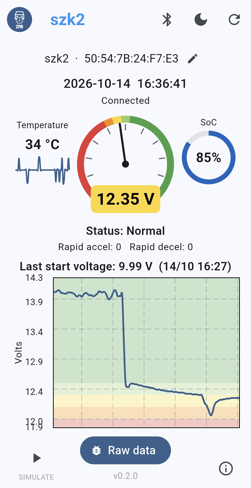
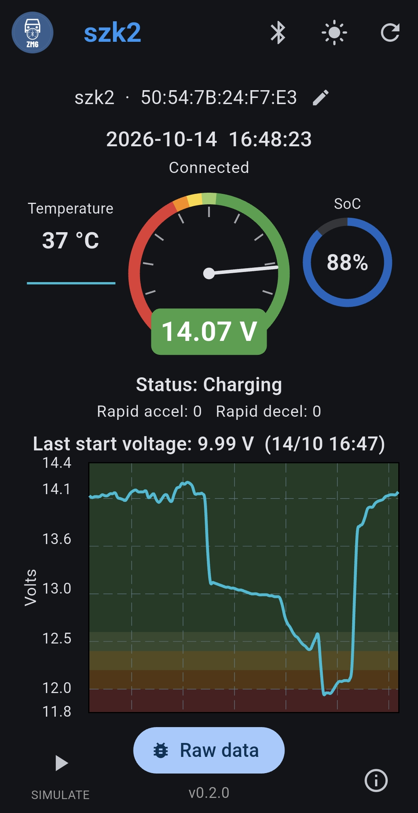
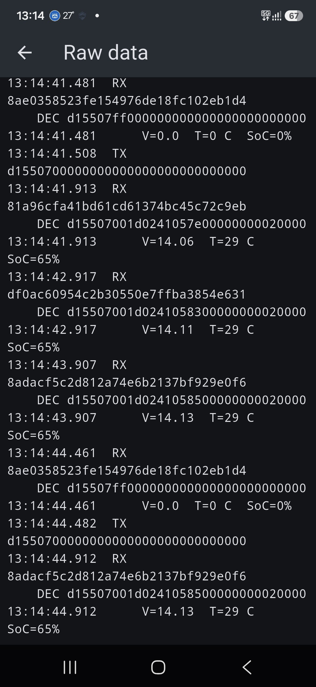

# ZM6 Battery Monitor

Android app (Flutter) that reads voltage from **BM6 BLE battery monitors**
directly over the phone's Bluetooth, no vendor app required.

This project is a Flutter port of
[JeffWDH/bm6-battery-monitor](https://github.com/JeffWDH/bm6-battery-monitor)
(Python). The BLE protocol was implemented from that project.

## Screenshots

<p align="center">
  <a href="docs/screenshots/scr1.jpg"></a>
  <a href="docs/screenshots/scr2.jpg"></a>
  <a href="docs/screenshots/raw.jpg"></a>
</p>

## Features

- Analog/Digital voltage gauge with colored status bands
- State of charge (SoC) dial
- Temperature with a 1-minute sparkline
- Rapid acceleration / deceleration counters
- Last engine start voltage
- Real-time voltage chart with status bands
- Per-device history stored on the phone (never deleted automatically; it
  can be cleared from the Bluetooth connection dialog, after confirmation)
- Raw data screen: TX / RX packets, decrypted payload and parsed values
- Bluetooth connection info and device rename (stored per MAC address)
- Light / dark mode
- Built-in data simulation (play button, bottom left) to preview the UI without
  a sensor
- Auto-connects to the first device advertising as `BM6` and reconnects
  automatically (every 15 s) when the connection is lost, also in the
  background through a silent foreground-service notification

## Protocol

BLE service characteristics: write to `FFF3`, notifications on `FFF4`.
Every frame is one 16-byte block, AES-128-CBC (no padding, zero IV) with the
key `6c6561 67656e64 fffe 30313030 3030 39` (`leagendÿþ0100009`).

Commands are 16 bytes: `d1 55 <op> 00 ...` (padded with zeros), encrypted
before writing:

| Op | Command | Description |
|---|---|---|
| `01` | `d1550100...` | firmware version |
| `03` | `d1550300...` | last engine start (crank) data |
| `07` | `d1550700...` | start the real-time stream |

### Real-time frame (`d1 55 07 ...`, decrypted)

| Byte | Field | Notes |
|---|---|---|
| 0-2 | `d1 55 07` | header |
| 3 | temperature sign | `01` = negative. `ff` = command acknowledge (no data, ignored) |
| 4 | temperature | degrees Celsius |
| 5 | status | `0` normal, `1` low voltage, `2` charging (engine running) |
| 6 | state of charge | percent |
| 7-8 | voltage | unsigned 16-bit big endian, divided by 100 |
| 9-10 | rapid accelerations | counter |
| 11-12 | rapid decelerations | counter |
| 13-15 | reserved | not used |

Frames whose byte 3 is `ff` (or whose voltage is 0) are not readings; the app
ignores them. Readings arrive about once per second.

### Last start frame (`d1 55 03 ...`, decrypted)

| Byte | Field | Notes |
|---|---|---|
| 3 | status | `ff` = no start data stored |
| 4-5 | start voltage | unsigned 16-bit, divided by 100 |
| 6-7 | duration | |
| 8-9 | age | in units of 2 minutes before now |

Further frames of the same response carry the voltage curve of the start and
are currently ignored.

### Voltage bands

| Voltage | Meaning |
|---|---|
| 12.6 V and above | Fully charged and healthy |
| 12.4 - 12.6 V | About 75% |
| 12.2 - 12.4 V | About 50% |
| 12.0 - 12.2 V | Low charge |
| Below 12.0 V | Discharged or faulty (a damaged cell may drop to about 10.5 V or less) |

## Battery type

All voltage and state-of-charge interpretation in this app (status bands, gauge
colors, SoC dial colors) assumes a **liquid (flooded) lead-acid** 12 V battery,
the usual starter battery. Other chemistries (AGM, gel, lithium) have different
resting voltages, so the bands and colors will not be accurate for them.

Lead-acid batteries should not stay below about 50% charge for long, because of
sulphation; keeping them above 70% is recommended for a long service life.

## History

Every reading is saved on the phone, per device (BLE address), and is never
deleted automatically. The chart is preloaded with the latest samples when the
app connects. The refresh button only reconnects; the history of the current
device is cleared from the Bluetooth connection dialog (with confirmation).

## Requirements

- Android 6.0+ (minimum supported by the app; see the note below)
- [Flutter](https://docs.flutter.dev/get-started/install) 3.x
- A BM6 battery monitor

> **Tested on Android 16 (arm64) and Android 10 (32-bit).** It may work on other Android versions and
> devices, but that has not been verified.

## Download

Prebuilt APKs are available on the
[Releases](https://github.com/caduaraxa/zm6-battery-monitor/releases) page for
both ARM architectures:

- `zm6-vX.Y.Z.apk` — ARM 64-bit (arm64-v8a), most modern phones
- `zm6-vX.Y.Z-32bits.apk` — ARM 32-bit (armeabi-v7a), older phones

## Build

```
flutter pub get
flutter build apk --release --target-platform android-arm64   # 64-bit
flutter build apk --release --target-platform android-arm     # 32-bit
```

The APK is generated at `build/app/outputs/flutter-apk/app-release.apk`.

## Permissions

On first launch the app asks for Bluetooth, location and notification access.
Android requires location permission for BLE scanning; the location is not
used. The notification is the (silent) foreground service that keeps the
connection alive in the background; closing the app removes it.

## Future feature suggestions

- Manage devices (colours, per-device settings)
- Minimum/maximum voltage alarm
- Cranking voltage test (using historical data)
- Settings menu (automatic reconnect, panels, graphs, auto-update)

## Versioning

[Semantic Versioning](https://semver.org/). The version lives in `pubspec.yaml`
(`version: MAJOR.MINOR.PATCH+BUILD`). See [CHANGELOG.md](CHANGELOG.md).

## Credits

Original Python scripts and studies in reverse engineering BLE protocols:
- [JeffWDH/bm6-battery-monitor](https://github.com/JeffWDH/bm6-battery-monitor) - original Python implementation
- [KrystianD/bm2-battery-monitor](https://github.com/KrystianD/bm2-battery-monitor/blob/master/.docs/reverse_engineering.md)
- [doubleagent.net - BM2 BLE protocol](https://doubleagent.net/bm2-reversing-the-ble-protocol-of-the-bm2-battery-monitor/)
- [Reverse Engineering](https://www.tarball.ca/posts/reverse-engineering-the-bm6-ble-battery-monitor/)

## License

[MIT](LICENSE)
